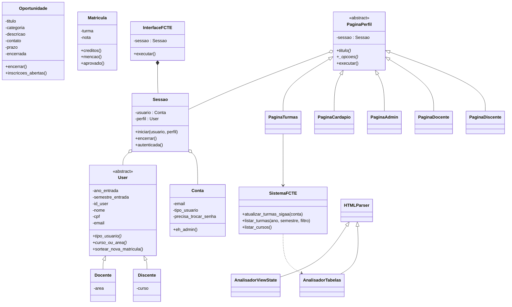
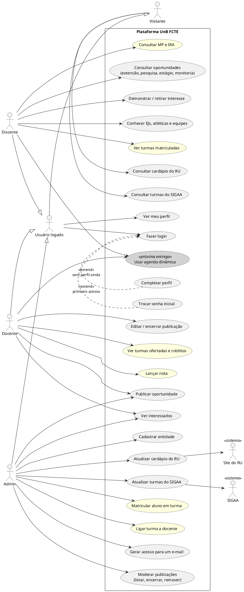

# Diagramas UML

## Diagrama de classes

O GitHub desenha este diagrama automaticamente (Mermaid). As funções de módulo (`login.py`, `banco.py`,
`turmas.py`, `horarios.py`) não aparecem aqui; elas funcionam como a camada de serviço.

## Diagrama de casos de uso

O GitHub não desenha PlantUML. Para ver a imagem, cole o código em <https://www.plantuml.com/plantuml>
ou use a extensão "PlantUML" do VS Code.

Legenda: branco = funciona no menu; amarelo = pronto no backend, sem menu ainda; cinza = próximas entregas.

Observações:
- **Herança de atores:** todo usuário logado também é visitante, então também vê o RU e as turmas.
  Discente, docente e admin herdam o login de "Usuário logado".
- **`<<extend>>`:** trocar a senha e completar o perfil só acontecem dentro do login, e só quando é preciso
  (primeiro acesso, ou alguém que ainda não tem perfil). O admin nunca completa perfil.
- **Sistemas externos:** o SIGAA e o site do RU são atores secundários; o sistema busca dados neles.
