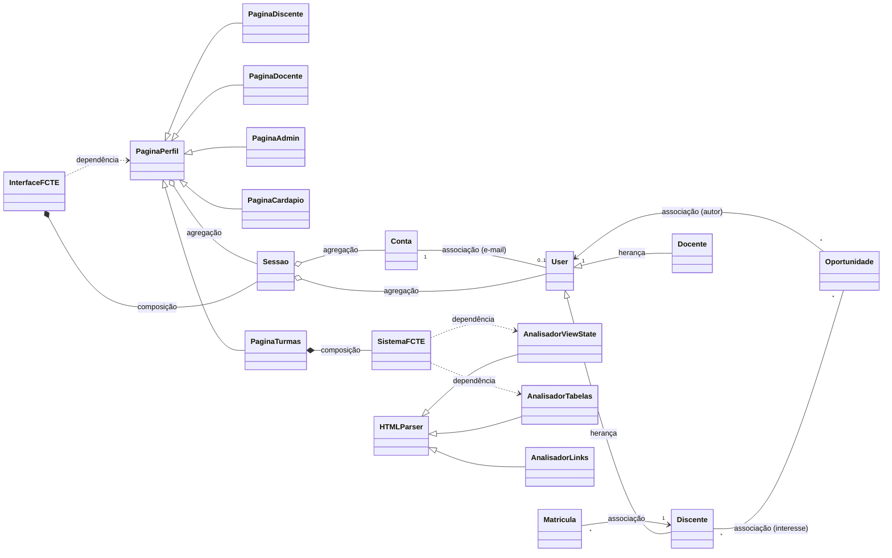

# Relações entre classes e objetos

Mapa dos conceitos de Orientação a Objetos usados no projeto: onde cada um aparece e por que foi usado.
Todos os arquivos citados estão em `code_py/`.

## Visão geral



Notação: `<|--` herança, `*--` composição, `o--` agregação, `--`/`-->` associação, `..>` dependência.

---

## 1. Herança

| Classe base | Classes filhas | Arquivo |
|---|---|---|
| `User` (abstrata) | `Discente`, `Docente` | `user.py` |
| `PaginaPerfil` (abstrata) | `PaginaDiscente`, `PaginaDocente`, `PaginaAdmin`, `PaginaCardapio`, `PaginaTurmas` | `paginas.py` |
| `HTMLParser` (biblioteca padrão) | `AnalisadorViewState`, `AnalisadorTabelas` | `system.py` |
| `HTMLParser` (biblioteca padrão) | `AnalisadorLinks` | `cardapio.py` |

- **`User` → `Discente`, `Docente`:** o que é comum fica na base: nome, CPF validado, e-mail validado,
  ano e semestre de entrada e a matrícula sorteada. Cada filha chama `super().__init__(...)` e acrescenta só
  o que é dela: `curso` no discente, `area` no docente.
- **`PaginaPerfil` → páginas:** a base tem o laço do menu (`executar`), a leitura das entradas
  (`_escolher`, `_confirmar`, `_ler_prazo`, `_ler_id`) e as ações que mais de um perfil usa
  (`_publicar`, `_interessados`, `_encerrar`, `_ver_perfil`). As filhas só dizem o título e as opções.
- **`HTMLParser` → analisadores:** herança de uma classe da biblioteca padrão para ler o HTML do SIGAA e do site do RU.

**Classes abstratas (`ABC`):** `User` e `PaginaPerfil` não podem ser instanciadas, porque elas existem
só para serem herdadas. Tentar criar uma dá erro:

```text
>>> User(2024, 1, 'X', None, 'x@unb.br')
TypeError: Can't instantiate abstract class User without an implementation for abstract methods 'curso_ou_area', 'tipo_usuario'
```

## 2. Polimorfismo

O mesmo comando funciona com objetos de classes diferentes, e cada objeto responde do seu jeito.

1. **Propriedades abstratas sobrescritas** (`user.py`): `tipo_usuario` e `curso_ou_area` são
   `@abstractmethod` em `User`. O `Discente` devolve `'discente'` e o curso, e o `Docente` devolve
   `'docente'` e a área. O cabeçalho do menu (`interface.py`) imprime `perfil.curso_ou_area` sem saber qual dos dois recebeu.
2. **Template method nas páginas** (`paginas.py`): `PaginaPerfil.executar()` chama `self.titulo` e
   `self._opcoes()`, que são abstratos. Cada página preenche esses dois pontos, e o laço do menu é escrito uma vez só.
3. **Escolha da classe em tempo de execução:**
   - `criar_pagina(sessao)` consulta o dicionário `paginas_por_tipo` e cria `PaginaDiscente`,
     `PaginaDocente` ou `PaginaAdmin`; quem chama só faz `.executar()`.
   - Do mesmo jeito, `banco.cadastrar_perfil` escolhe `classe = Discente if ... else Docente` e cria o objeto.
4. **Propriedade sobrescrita em uma filha:** na base, `_autor` devolve o perfil do docente. A `PaginaAdmin`
   sobrescreve `_autor` para devolver a `Conta` do admin, porque o admin não tem perfil. Com isso, os métodos herdados
   `_publicar`, `_interessados` e `_encerrar` servem para os dois sem nenhum `if`.
5. **Atributo de classe sobrescrito:** `exige_login = True` na base; `PaginaCardapio` e `PaginaTurmas`
   mudam para `False` e por isso abrem no portal público, sem login.
6. **Métodos de gancho do `HTMLParser`:** `feed()` (da biblioteca) chama `handle_starttag`, `handle_data`
   e `handle_endtag`. Cada analisador sobrescreve esses métodos para procurar algo diferente:
   - `AnalisadorViewState` procura o `ViewState`;
   - `AnalisadorTabelas` procura as linhas das tabelas;
   - `AnalisadorLinks` procura os links dos PDFs.
7. **`__str__`:** `Oportunidade` e `Matricula` definem `__str__`, então `print(objeto)` mostra cada
   um formatado do seu jeito (`PaginaPerfil._mostrar`).
8. **Duck typing:**
   - `organizacoes.publicar(autor, ...)` aceita um `Docente` ou a `Conta` de um admin, porque os dois
     têm `tipo_usuario`.
   - `login.exigir_admin(conta)` usa `getattr(conta, 'eh_admin', False)` e aceita qualquer objeto: se não
     tiver `eh_admin`, simplesmente não é admin.

## 3. Composição

A parte é **criada pelo todo** e só existe enquanto ele existir.

| Todo | Parte | Onde a parte nasce |
|---|---|---|
| `InterfaceFCTE` | `Sessao` | `InterfaceFCTE.__init__`: `self.__sessao = Sessao()` (privada) |
| `PaginaTurmas` | `SistemaFCTE` | `PaginaTurmas.__init__`: `self._sistema = SistemaFCTE()` |

A `Sessao` só existe enquanto o programa (`InterfaceFCTE`) está rodando. Ninguém de fora cria ou substitui essa sessão.

## 4. Agregação

O objeto **guarda uma referência** a outro, mas não o cria: a parte vem de fora e pode existir sem o todo.

| Todo | Parte | Como chega |
|---|---|---|
| `Sessao` | `Conta` | `sessao.iniciar(conta, perfil)`; a `Conta` é criada por `login.autenticar` |
| `Sessao` | `Discente` / `Docente` | mesma chamada; o perfil é criado por `banco.buscar_perfil` |
| `PaginaPerfil` (e filhas) | `Sessao` | recebida no construtor: `PaginaDiscente(sessao)` |

Todas as páginas recebem **o mesmo objeto `Sessao`** da interface. Por isso, quando a sessão é encerrada,
todos os menus que exigem login percebem e se fecham (`ativo=lambda: ... self._sessao.autenticada`).

## 5. Associações

Ligações duradouras entre objetos, gravadas no banco pela chave do outro objeto. Os objetos são recriados ao ler
(`banco.__reconstruir`, `organizacoes._reconstruir`).

| Associação | Multiplicidade | Como é guardada |
|---|---|---|
| `Conta` — perfil (`Discente`/`Docente`) | 1 para 0..1 (o admin não tem perfil) | `usuarios.email` referencia `acessos.email` |
| `Oportunidade` → autor | muitas para 1 | `autor_id` (matrícula do docente, ou `admin:e-mail`) |
| `Discente` — `Oportunidade` (interesse) | muitos para muitos | tabela `interesses` |
| `Discente` — turma (matrícula, com nota) | muitos para muitos | tabela `matriculas`; `turmas.Matricula` representa uma linha |
| `Docente` — turma (oferta) | 1 docente para muitas turmas | tabela `ofertas` |

## 6. Dependências

Uma classe **usa** outra só por um momento: recebe como parâmetro, cria dentro de uma função ou só chama.
Ela não guarda o objeto depois.

- **`InterfaceFCTE` → páginas:** cria `PaginaCardapio(...)`, `PaginaTurmas(...)` ou `criar_pagina(...)` a cada
  escolha do menu, chama `.executar()` e descarta a página.
- **`SistemaFCTE` → `AnalisadorViewState`, `AnalisadorTabelas`:** criados dentro de `buscar_turmas_publicas`
  só para ler uma página do SIGAA. `cardapio.py` faz o mesmo com `AnalisadorLinks`.
- **`banco` → `Discente`, `Docente`:** `cadastrar_perfil` e `__reconstruir` criam os objetos.
- **`login` → `Conta`:** `autenticar` e `criar_admin_inicial` funcionam como fábricas de `Conta`.
- **Parâmetros:**
  - `gerar_acesso(admin, ...)` e `exigir_admin(conta)` dependem de `Conta`;
  - `turmas.lancar_nota(docente, ...)`, `turmas.ira(perfil)` e `organizacoes.demonstrar_interesse(perfil, ...)`
    dependem dos perfis.

## 7. Encapsulamento (base de tudo acima)

- **Atributos privados:** `__nome` e `__cpf` em `User`, `__curso` em `Discente`, `__tipo_usuario` em `Conta`… O Python troca internamente o nome
  (`__nome` vira `_User__nome`), então de fora não dá para acessar `objeto.__nome`.
- **Somente leitura:** `@property` sem setter. Tentar `perfil.cpf = '1'` gera `AttributeError`.
- **Validação nos setters:** `Discente.curso`, `Docente.area` e os textos de `Oportunidade` conferem o valor
  antes de guardar. Por exemplo, `aluno.curso = 'Medicina'` gera `ValueError: Curso indisponível.`
- **Método privado:** `User.__gerar_id` sorteia a matrícula. De fora, só existe `sortear_nova_matricula()`, que o banco
  chama quando a matrícula sorteada já está em uso.
- **Estado protegido:** a `Sessao` não pode ser trocada no meio. Chamar `iniciar` com uma sessão ativa gera erro.
